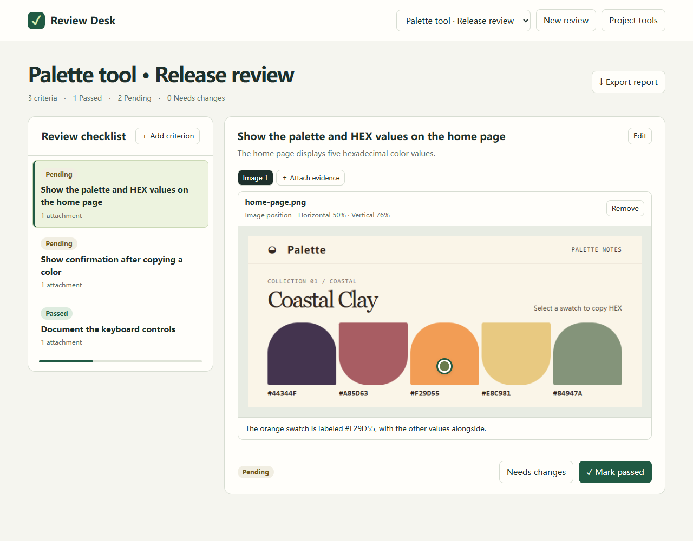

<div align="center">

# Review Desk

### Give every requirement a place to be checked.

Turn a delivery into a clear review checklist. Connect each requirement to a screenshot, a moment in a video, or a paragraph in a document. Record your decision and send actionable feedback back to the people or AI agents doing the work.

**Local-first · No setup required · Evidence you can revisit**

[Get started](#get-started) · [See the workflow](#the-review-workflow) · [Features](#features) · [中文说明](README.zh-CN.md)

</div>



<p align="center"><em>The included palette project shows a requirement linked to the exact part of a screenshot to review.</em></p>


## From “looks done” to a review you can follow

A delivery can include a website, a recording, a document, and a list of requirements. Review Desk brings the review together in one place.

| Your task | What Review Desk provides |
| --- | --- |
| Define the work | Write requirements and create review criteria, or prepare a prompt for an external AI and import its checklist. |
| Find the evidence | Mark a point in an image, select a video timestamp, or highlight a document paragraph. |
| Make a decision | Mark a criterion as passed or needing changes, with a review note. |
| Follow changes | Record a requirement change, select affected criteria, and return them to review. |
| Send work back | Export a Markdown task containing items that need changes and their review notes. |
| Share the result | Export a standalone HTML report or a concise Markdown report. |
| Move your work | Back up a project with its attachments and import it as a separate project. |

## Get started

1. Download or clone this repository and keep its files together.
2. Open `index.html` in desktop Microsoft Edge or Google Chrome.
3. Explore the included fictional palette project, or select **New review** to create your own review.

The application runs locally in your browser. You do not need to install dependencies, run a server, or enter an API key.

### Try the sample

- Select **Show the palette and HEX values on the home page** to see a marked position on the palette screenshot.
- Select **Show confirmation after copying a color** to open the video at the saved 1.5-second mark.
- Select **Document the keyboard controls** to see the highlighted keyboard-instructions paragraph.
- Select **Mark passed** to approve a criterion, or **Needs changes** to leave an actionable comment.

## The review workflow

### 1. Create your checklist

Select **New review**, name the project, and choose **Add criterion** to add a requirement. Include a clear description of what the reviewer should check.

For AI-assisted drafting, open **Project tools → Requirements & AI checklist**, enter your project requirements, and choose **Download AI prompt**. Give the downloaded prompt to your preferred AI assistant. Review its response, paste the JSON array into the dialog, and save it.

```json
[
  {
    "title": "Show a confirmation after copying",
    "detail": "After the user clicks a color, show the copied HEX value."
  }
]
```

Each imported item becomes a pending criterion. The external AI generates the draft. Review Desk does not send your requirements to a model.

### 2. Attach evidence

Select a criterion, then choose **Attach evidence**. You can attach multiple pieces of evidence to the same criterion.

| Evidence | Supported formats | How to locate it |
| --- | --- | --- |
| Screenshot | PNG, JPEG, WebP | Click the image or enter percentage coordinates. |
| Recording | MP4 or WebM supported by your browser | Move the playhead to the moment you want to review. |
| Document | UTF-8 TXT or Markdown, up to 2 MB per file | Select a paragraph. Blank lines separate paragraphs. |

Add an optional caption to explain what the evidence shows. Videos reopen at the saved timestamp, and **Return to mark** returns the player to it.

### 3. Review and record feedback

Choose **Mark passed** to mark a criterion as passed, or **Needs changes** to record what needs work. Passing requires at least one attached piece of evidence. A change request requires a review note.

When a criterion is edited or its evidence is added or removed, its review decision returns to pending. This keeps the checklist aligned with what was actually reviewed.

### 4. Handle changes and revisions

Open **Project tools → Track requirement changes** to record a change and select the affected criteria. Their previous decisions and notes remain in the change history, and the selected criteria return to pending.

Saving different project requirements in **Requirements & AI checklist** returns all existing criteria to pending and records their previous decisions in the change history.

For a visual comparison, attach at least two screenshots to the same criterion, then open **Project tools → Compare evidence**. Choose the images to view side by side.

### 5. Send feedback and share the review

- **Modification instructions** — Open **Project tools → Generate revision instructions** to download a Markdown task containing criteria marked as needing changes, review notes, and evidence references. Send the referenced files separately.
- **Standalone report** — Select **Export report** and choose HTML. The downloaded file includes the linked images, full videos, and document text for offline viewing.
- **Markdown report** — Choose Markdown in the export dialog for review decisions, notes, file names, locations, and selected text excerpts. It can be pasted into an issue or pull request.
- **Editable project backup** — Open **Project tools → Export project backup** to save a JSON backup containing the project and attachments. Use **Import project backup** to create an independent copy in another browser. The English and Chinese editions use separate browser storage. Use a project backup to transfer a review between them.

## Features

- **Multiple projects** with a switcher in the header.
- **Evidence anchors** for image coordinates, video timestamps, and text paragraphs.
- **Review decisions** with evidence requirements, change requests, and progress counts.
- **AI-assisted checklist drafting** through an exportable prompt and reviewed JSON import.
- **Requirement change history** and selective re-review.
- **Side-by-side screenshot comparison** within a criterion.
- **Portable HTML and Markdown reports**, plus editable project backups.
- **Local browser storage** for projects and attachments.

## Storage and current scope

Projects and uploaded attachments are stored in the browser's IndexedDB. Reopen the application with the same browser profile and from the same path. Clearing browser data can remove stored projects. Large videos are subject to browser storage limits.

HTML reports and project backups include full attachments. Check their contents before sharing. The current version relies on a person to select evidence and decide whether a criterion passes. AI checklist generation uses an external assistant, and image comparison is visual and manual.

## Development

Review Desk uses HTML, CSS, and JavaScript. The application itself has no installation dependencies.

The browser smoke tests use Node.js and Playwright. With Playwright available, run:

```sh
node tests/english.cjs
```

The tests use Playwright's Chromium by default. Set `EDGE_PATH` to a local Edge executable to run them with Edge.
