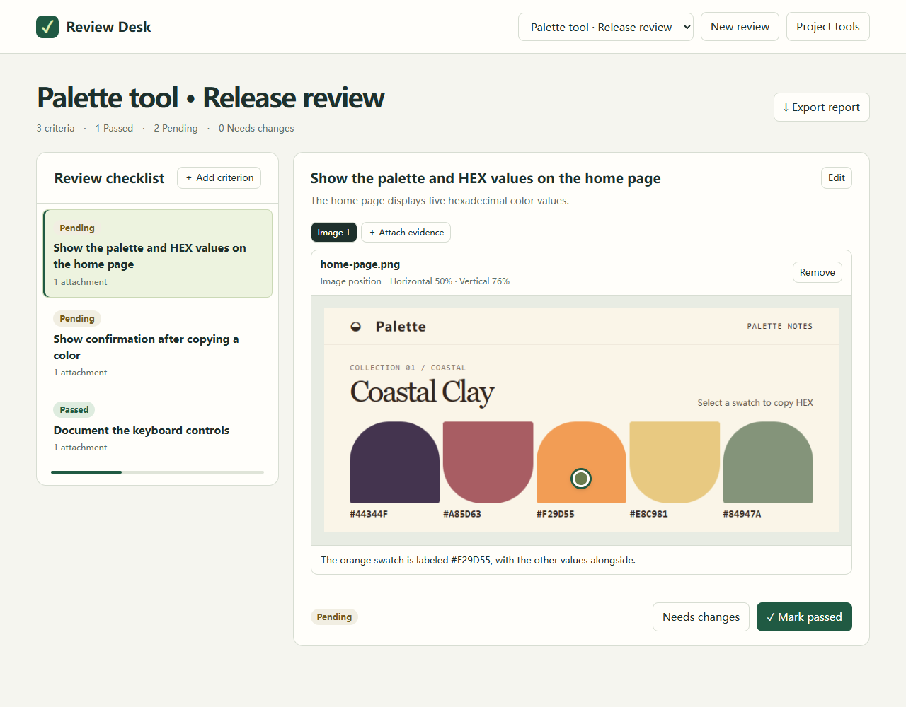

<div align="center">

# Review Desk · 交付验收台

### 让每一条需求都有据可查。

把交付要求整理成清晰的验收清单，让每条要求关联到截图位置、视频时刻或文档段落。记录复核结论，生成修改意见，与协作者或 AI 一起推进交付。

**本地运行 · 开箱即用 · 证据可追溯**

[English](README.md) · [快速开始](#快速开始) · [使用流程](#使用流程) · [数据存储](#数据存储)

</div>



<p align="center"><em>内置示例将验收条件关联到色板截图中的具体位置。</em></p>

## 从需求到复核

| 要完成的事情 | Review Desk 提供的功能 |
| --- | --- |
| 整理需求 | 手动添加验收条件，或导出提示词交给外部 AI，再导入其生成的清单。 |
| 定位证据 | 标记截图坐标、视频时间点或文档段落。 |
| 记录结论 | 标记通过或需要修改，并填写复核意见。 |
| 跟踪变化 | 记录需求变更，选择受影响的条件并重新复核。 |
| 反馈修改 | 将需要修改的条件和意见导出为 Markdown 指令。 |
| 分享结果 | 导出可离线查看的 HTML 报告，或导出 Markdown 报告。 |
| 备份项目 | 将验收单及其附件一起导出，并在其他浏览器导入。 |

## 快速开始

1. 下载或克隆本仓库，保持文件夹结构完整。
2. 使用桌面版 Microsoft Edge 或 Google Chrome 打开 `index.html`。
3. 体验内置的虚构色板示例，或点击 **New review** 新建验收单。

程序在浏览器中本地运行，无需安装依赖、启动服务或配置 API 密钥。当前这份发布包的产品界面为英文，下面列出界面中的英文按钮。

### 体验内置示例

- 选择 **Show the palette and HEX values on the home page**，查看截图中的标记。
- 选择 **Show confirmation after copying a color**，查看从 1.5 秒处开始的视频。
- 选择 **Document the keyboard controls**，查看高亮的键盘操作说明。
- 点击 **Mark passed** 标记通过，或选择 **Needs changes** 提出修改意见。

## 使用流程

### 1. 创建验收清单

点击 **New review**，输入项目名称，再通过 **Add criterion** 添加验收条件和判断方式。

也可以打开 **Project tools → Requirements & AI checklist**，填写需求后选择 **Download AI prompt**。将提示词交给外部 AI，检查其返回的 JSON 数组，再粘贴到页面并保存。每个导入的项目都会成为待复核条件。

```json
[
  {
    "title": "Show a confirmation after copying",
    "detail": "After the user clicks a color, show the copied HEX value."
  }
]
```

清单由外部 AI 生成，Review Desk 不会自动将需求发送给模型。

### 2. 关联证据

选择一条条件，点击 **Attach evidence**。一条条件可以关联多份证据，并可为证据添加说明。

| 证据类型 | 支持格式 | 定位方式 |
| --- | --- | --- |
| 截图 | PNG、JPEG、WebP | 点击图片或输入百分比坐标。 |
| 录屏 | 浏览器支持解码的 MP4、WebM | 将播放头移动到目标时刻后保存。 |
| 文档 | UTF-8 编码的 TXT、Markdown，每份不超过 2 MB | 选择段落，空行用于分段。 |

视频会定位到保存的时间点，点击 **Return to mark** 可再次回到标记位置。

### 3. 复核与反馈

查看证据后选择 **Mark passed** 或 **Needs changes**。标记通过前需要先关联证据，选择需要修改时需要填写意见。

修改验收条件、添加证据或移除证据后，该条件会重新变为待复核。

### 4. 跟踪需求变更

打开 **Project tools → Track requirement changes**，填写变更内容并选择受影响的条件。被选中的条件重新进入待复核，之前的状态和意见会保存在变更历史中。

在 **Requirements & AI checklist** 中保存不同的项目需求时，所有现有条件会重新进入待复核，原有结论会记录在变更历史中。

要对比新旧截图，先为同一条条件添加至少两张图片，再打开 **Project tools → Compare evidence**，选择图片并排查看。

### 5. 分享报告与修改指令

- **修改指令** — 打开 **Project tools → Generate revision instructions**，下载包含待修改条件、意见和证据引用的 Markdown。需要把引用的附件另行提供给执行修改的人或 AI。
- **HTML 报告** — 点击 **Export report** 并选择 HTML，生成可离线查看的报告，包含关联的图片、完整视频和文档全文。
- **Markdown 报告** — 在导出对话框中选择 Markdown，生成包含结论、意见、文件名、定位和选中段落的文字报告。
- **项目备份** — 使用 **Project tools → Export project backup** 导出项目和附件，再用 **Import project backup** 导入为独立项目。

## 数据存储

项目和附件保存在浏览器的 IndexedDB 中。请使用同一浏览器配置并从同一路径打开程序。清理浏览器数据可能删除记录，大视频受浏览器存储配额限制。

HTML 报告和项目备份包含完整附件，分享前请检查内容。当前版本由使用者选择证据并作出复核结论，截图对比通过人工观察完成。

英文版和独立的中文版使用不同的浏览器存储。可以通过项目备份在两个版本之间转移验收单，项目中原有的文字保持原语言。

## 开发与测试

应用使用 HTML、CSS 和 JavaScript。浏览器测试需要 Node.js 和 Playwright。在可加载 Playwright 的环境中运行：

```sh
node tests/english.cjs
```

测试默认使用 Playwright Chromium。可将 `EDGE_PATH` 设置为本机 Edge 的可执行文件路径。
