<div align="center">

# Review Desk

### Give every requirement a place to be checked.

Turn a delivery into a clear review checklist. Connect each requirement to a screenshot, a moment in a video, or a paragraph in a document. Record your decision and send actionable feedback back to the people or AI agents doing the work.

**Local-first · No setup required · Evidence you can revisit**

[Get started](#get-started) · [See the workflow](#the-review-workflow) · [Features](#features) · [中文说明](README.zh-CN.md)

</div>

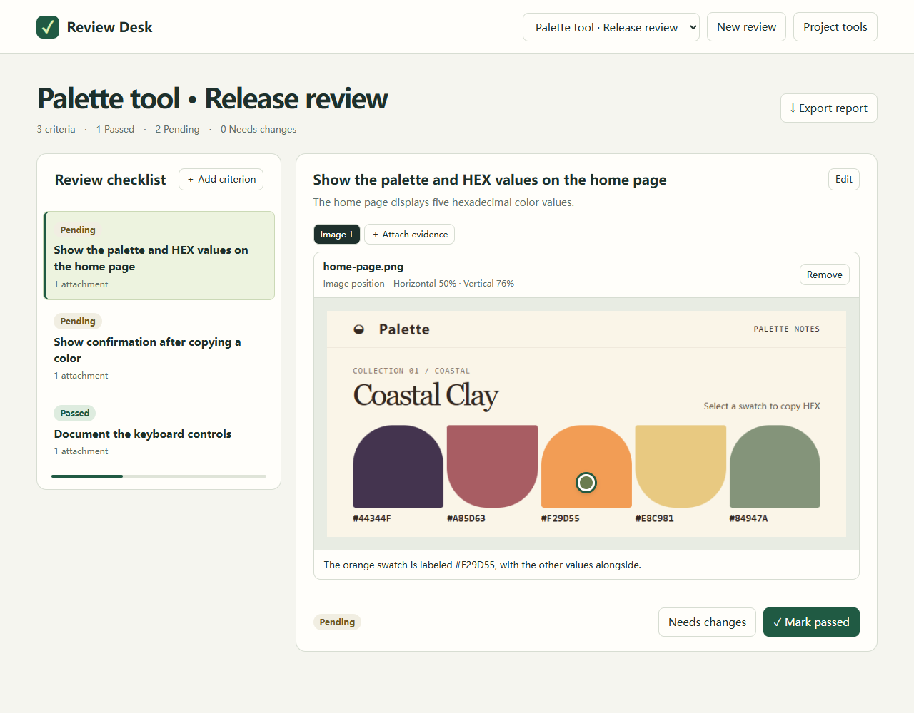

<p align="center"><em>The included palette project shows a requirement linked to the exact part of a screenshot to review.</em></p>


## From “looks done” to a review you can follow

A delivery can include a website, a recording, a document, and a list of requirements. Review Desk brings the review together in one place.

| Your task | What Review Desk provides |
| --- | --- |
| Define the work | Write requirements and create review criteria, or prepare a prompt for an external AI and import its checklist. |
| Find the evidence | Mark a point in an image, select a video timestamp, or highlight a document paragraph. |
| Make a decision | Mark a criterion as passed or needing changes, with a review note. |
| Follow changes | Record a requirement change, select affected criteria, and return them to review. |
| Send work back | Export a Markdown task containing items that need changes and their review notes. |
| Share the result | Export a standalone HTML report or a concise Markdown report. |
| Move your work | Back up a project with its attachments and import it as a separate project. |

## Get started

1. Download or clone this repository and keep its files together.
2. Open `index.html` for English or `zh/index.html` for Chinese in desktop Microsoft Edge or Google Chrome.
3. Explore the included fictional palette project, or select **New review** to create your own review.

The application runs locally in your browser. You do not need to install dependencies, run a server, or enter an API key.

### Try the sample

- Select **Show the palette and HEX values on the home page** to see a marked position on the palette screenshot.
- Select **Show confirmation after copying a color** to open the video at the saved 1.5-second mark.
- Select **Document the keyboard controls** to see the highlighted keyboard-instructions paragraph.
- Select **Mark passed** to approve a criterion, or **Needs changes** to leave an actionable comment.

## The review workflow

### 1. Explore the workspace

Open the root <code>index.html</code> in Edge or Chrome. The left side lists criteria and their status. Select a criterion to inspect its evidence on the right. Use the selector in the top bar to switch projects.

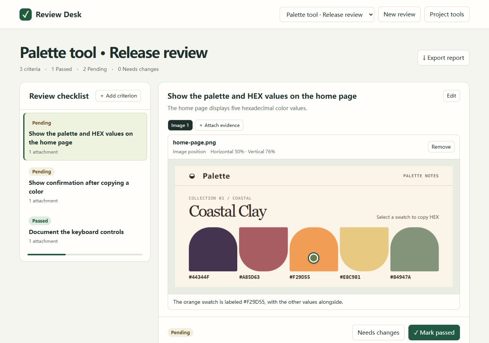

### 2. Create a review

Choose **New review**, enter a project name, and select **Save**. You can return to another project using the selector in the top bar.

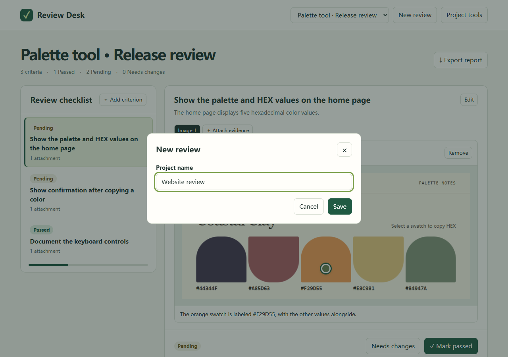

### 3. Add a criterion

Choose **Add criterion**. Enter the outcome in **Criterion**, explain how to check it in **How to verify**, and choose **Save**. The criterion starts as pending.

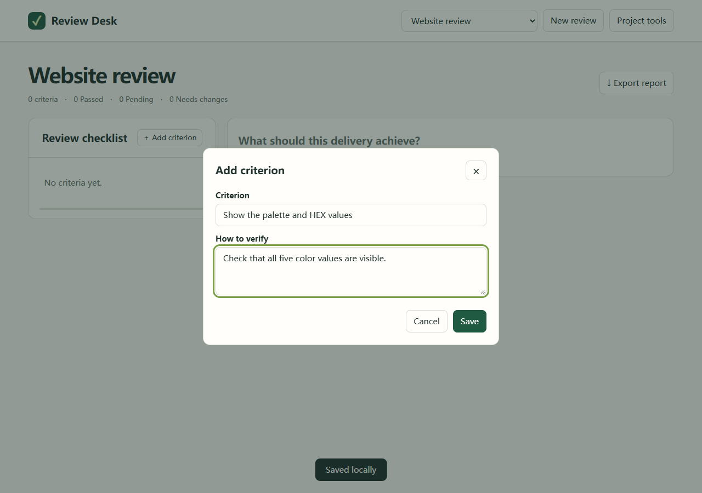

### 4. Attach an image

Select a criterion, then **Attach evidence**. Choose a PNG, JPEG, or WebP image. Click the preview to place the marker, or enter horizontal and vertical percentages. Add an optional caption and choose **Save**.

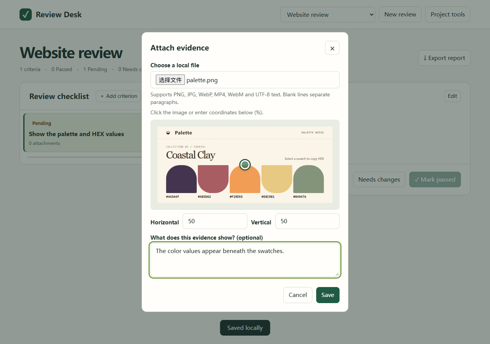

### 5. Attach a recording

Choose **Attach evidence** again and select an MP4 or WebM file your browser can decode. Move the video playhead to the desired moment and wait for the frame to load. Choose **Save**. **Return to mark** revisits the saved time.

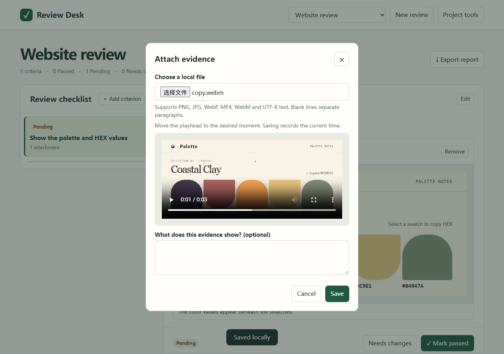

### 6. Attach a document

Choose **Attach evidence** and select a UTF-8 TXT or Markdown file up to 2 MB. Select a paragraph from the list and check the excerpt before saving. Blank lines separate paragraphs.

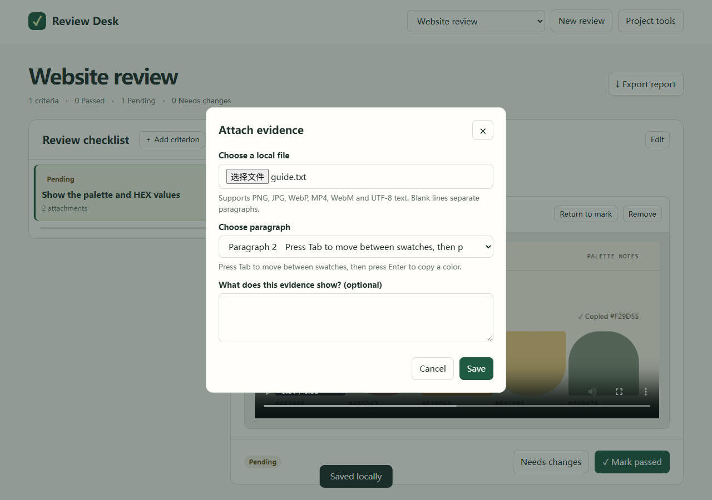

### 7. Record a decision

Review the linked evidence and choose **Mark passed** or **Needs changes**. Passing requires at least one attachment. For a change request, enter the required feedback and choose **Save**. Editing the criterion or changing its evidence resets the decision to pending.

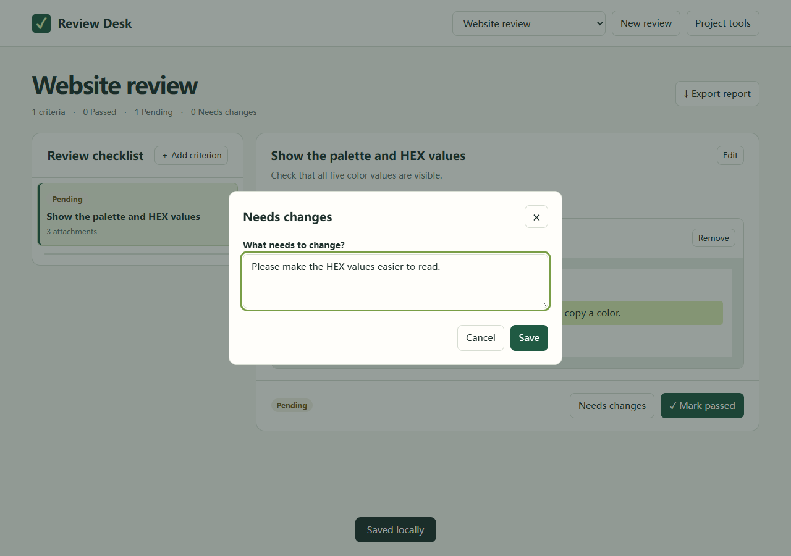

### 8. Prepare revision instructions

Open **Project tools → Generate revision instructions**. Review or edit the generated text and select **Download**. The Markdown lists criteria marked as needing changes, notes, and references. Provide the referenced files separately to the person or AI making changes.

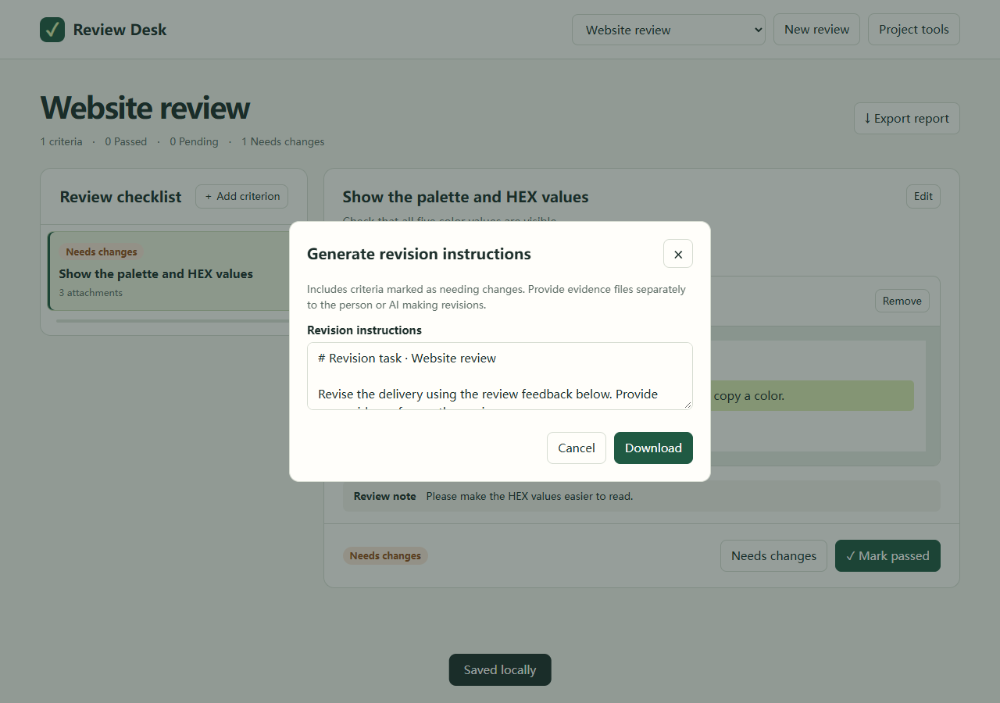

### 9. Draft a checklist with AI

Open **Project tools → Requirements & AI checklist** and enter the project requirements. Choose **Download AI prompt**, provide it to an external AI assistant, and review its response. Paste the JSON array into the optional field and select **Save**. Each item needs a non-empty <code>title</code> and a <code>detail</code> string. Saving changed requirements resets all existing criteria to pending and records previous decisions in history.

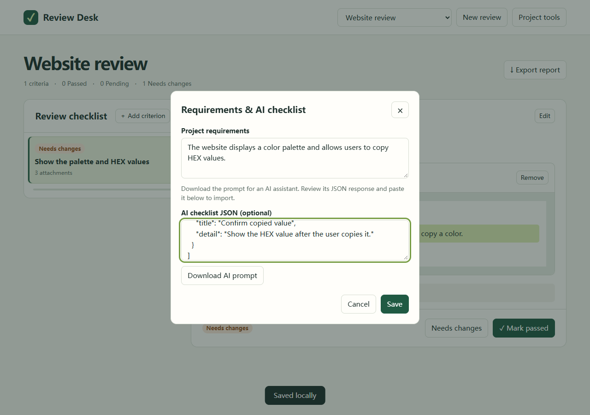

### 10. Track requirement changes

Open **Project tools → Track requirement changes**. Describe the change, tick affected criteria, and choose **Save**. Their previous statuses and notes remain in **View change history**, while selected criteria return to pending.

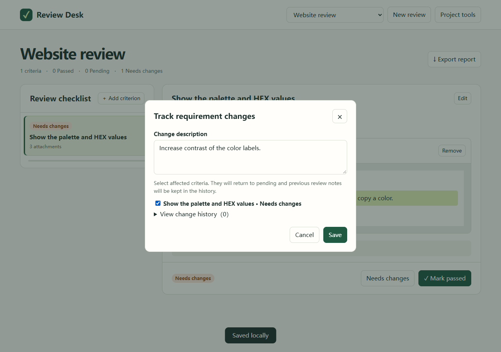

### 11. Compare screenshots

Attach at least two images to the same criterion, then open **Project tools → Compare evidence**. Use the **Left** and **Right** selectors to choose images for side-by-side inspection. The illustration uses two copies of the same sample image to show the controls.

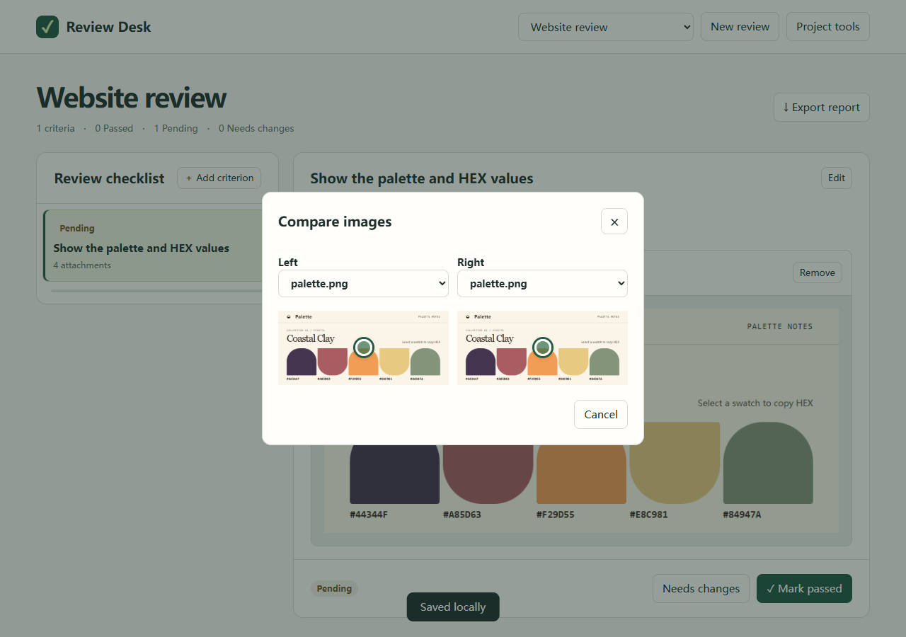

### 12. Export a review report

Choose **Export report**. Select HTML for a standalone offline report containing full attached images, videos, and document text. Select Markdown for decisions, notes, file names, locations, and selected text excerpts. Choose **Export** to download.

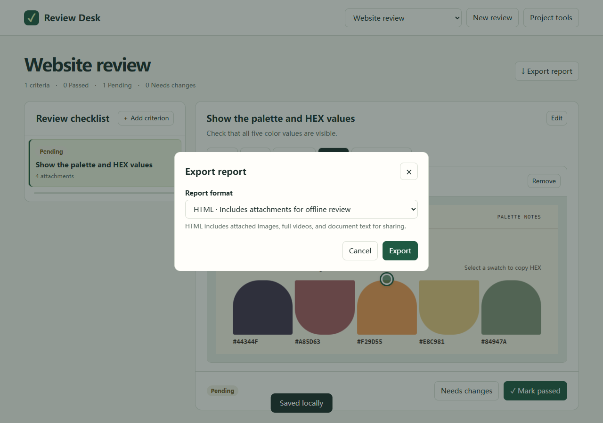

### 13. Back up a project

Open **Project tools → Export project backup** to download a JSON backup containing the current project and its attachments. The menu also provides the other project tools shown above.

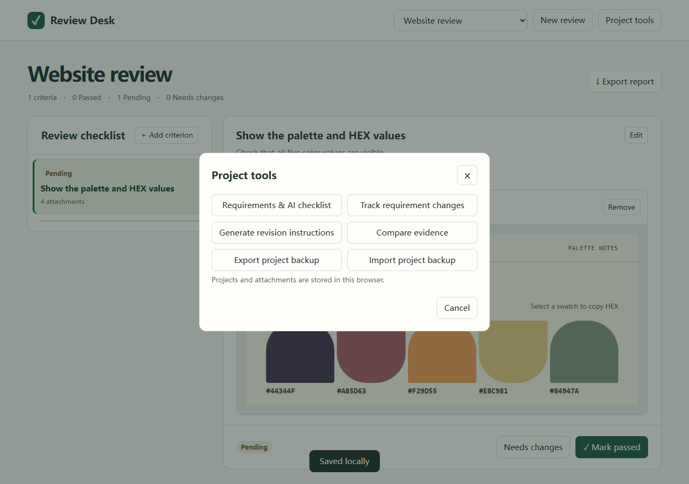

### 14. Restore a backup

Open **Project tools → Import project backup**, choose a Review Desk JSON backup, and select **Save**. The imported project is created as a separate copy. Review Desk keeps data in browser storage, so keep a backup before clearing browser data.

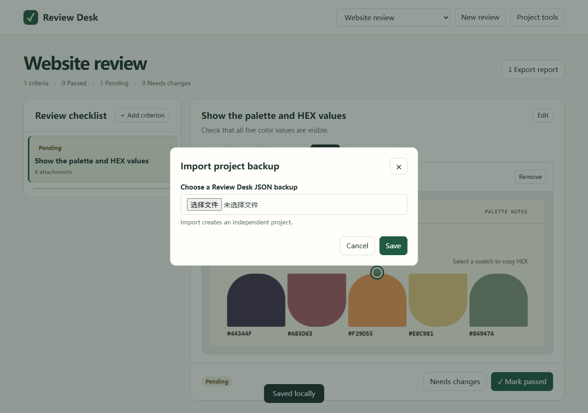


## Features

- **Multiple projects** with a switcher in the header.
- **Evidence anchors** for image coordinates, video timestamps, and text paragraphs.
- **Review decisions** with evidence requirements, change requests, and progress counts.
- **AI-assisted checklist drafting** through an exportable prompt and reviewed JSON import.
- **Requirement change history** and selective re-review.
- **Side-by-side screenshot comparison** within a criterion.
- **Portable HTML and Markdown reports**, plus editable project backups.
- **Local browser storage** for projects and attachments.

## Storage and current scope

Projects and uploaded attachments are stored in the browser's IndexedDB. Reopen the application with the same browser profile and from the same path. Clearing browser data can remove stored projects. Large videos are subject to browser storage limits.

HTML reports and project backups include full attachments. Check their contents before sharing. The current version relies on a person to select evidence and decide whether a criterion passes. AI checklist generation uses an external assistant, and image comparison is visual and manual.

## Development

Review Desk uses HTML, CSS, and JavaScript. The application itself has no installation dependencies.

The browser smoke tests use Node.js and Playwright. With Playwright available, run:

```sh
node tests/english.cjs
```

The tests use Playwright's Chromium by default. Set `EDGE_PATH` to a local Edge executable to run them with Edge.
