<div align="center">

# Review Desk · 交付验收台

### 让每一条需求都有据可查。

把交付要求整理成清晰的验收清单，让每条要求关联到截图位置、视频时刻或文档段落。记录复核结论，生成修改意见，与协作者或 AI 一起推进交付。

**本地运行 · 开箱即用 · 证据可追溯**

[English](README.md) · [快速开始](#快速开始) · [使用流程](#使用流程) · [数据存储](#数据存储)

</div>

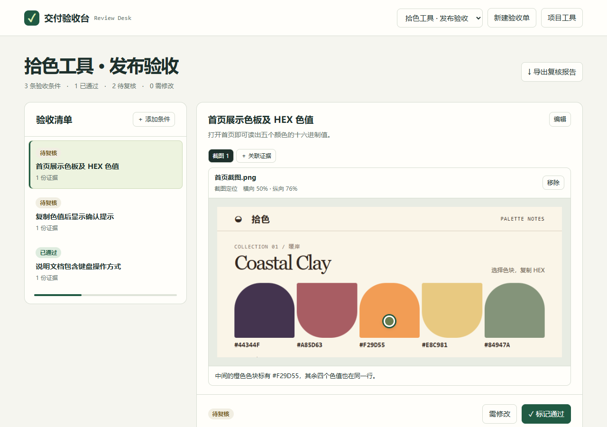

<p align="center"><em>内置示例将验收条件关联到色板截图中的具体位置。</em></p>

## 从需求到复核

| 要完成的事情 | Review Desk 提供的功能 |
| --- | --- |
| 整理需求 | 手动添加验收条件，或导出提示词交给外部 AI，再导入其生成的清单。 |
| 定位证据 | 标记截图坐标、视频时间点或文档段落。 |
| 记录结论 | 标记通过或需要修改，并填写复核意见。 |
| 跟踪变化 | 记录需求变更，选择受影响的条件并重新复核。 |
| 反馈修改 | 将需要修改的条件和意见导出为 Markdown 指令。 |
| 分享结果 | 导出可离线查看的 HTML 报告，或导出 Markdown 报告。 |
| 备份项目 | 将验收单及其附件一起导出，并在其他浏览器导入。 |

## 快速开始

1. 下载或克隆本仓库，保持文件夹结构完整。
2. 使用桌面版 Microsoft Edge 或 Google Chrome 打开 `zh/index.html`。
3. 体验内置的虚构色板示例，或点击 **新建验收单** 创建项目。

程序在浏览器中本地运行，无需安装依赖、启动服务或配置 API 密钥。发布包同时提供中文界面和英文界面。

### 体验内置示例

- 选择 **首页展示色板及 HEX 色值**，查看截图中的标记。
- 选择 **复制色值后显示确认提示**，查看从 1.5 秒处开始的视频。
- 选择 **说明文档包含键盘操作方式**，查看高亮的键盘操作说明。
- 点击 **标记通过** 标记通过，或选择 **需修改** 提出修改意见。

## 使用流程

### 1. 熟悉验收台

使用 Edge 或 Chrome 打开发布包中的 <code>zh/index.html</code>。左侧是验收条件和状态，点击任一条件后，右侧显示对应证据。顶部下拉菜单可以切换项目。


### 2. 新建验收单

点击右上角的 **新建验收单**，输入项目名称，然后点击 **保存**。之后可以通过顶部下拉菜单切换项目。

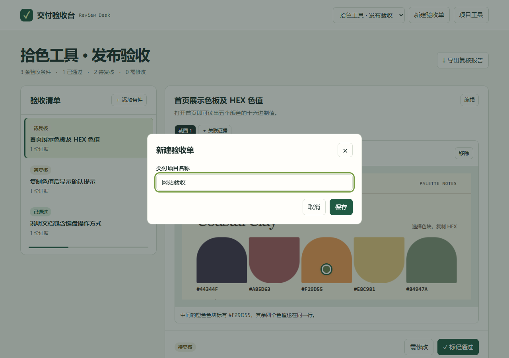

### 3. 添加验收条件

点击 **添加条件**。在「验收条件」中填写要达到的结果，在「如何判断已满足」中写明检查方式，然后点击 **保存**。新条件初始为待复核。

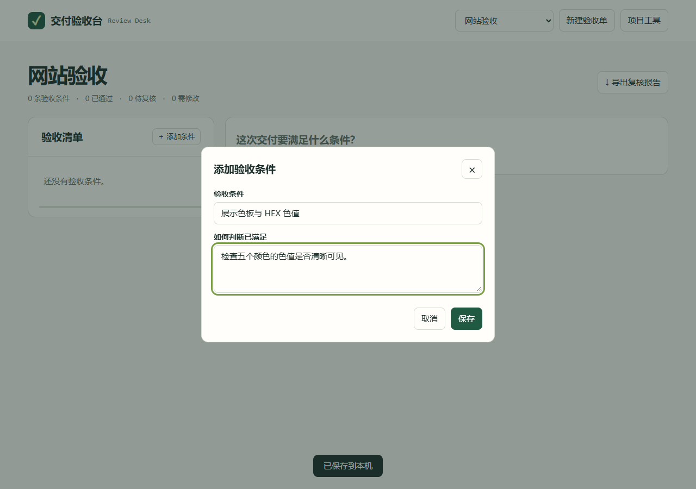

### 4. 关联截图

选择一条条件，点击 **关联证据**，选择 PNG、JPEG 或 WebP 图片。点击预览图设置标记，或输入横向、纵向百分比坐标。可填写证据说明，最后点击 **保存**。

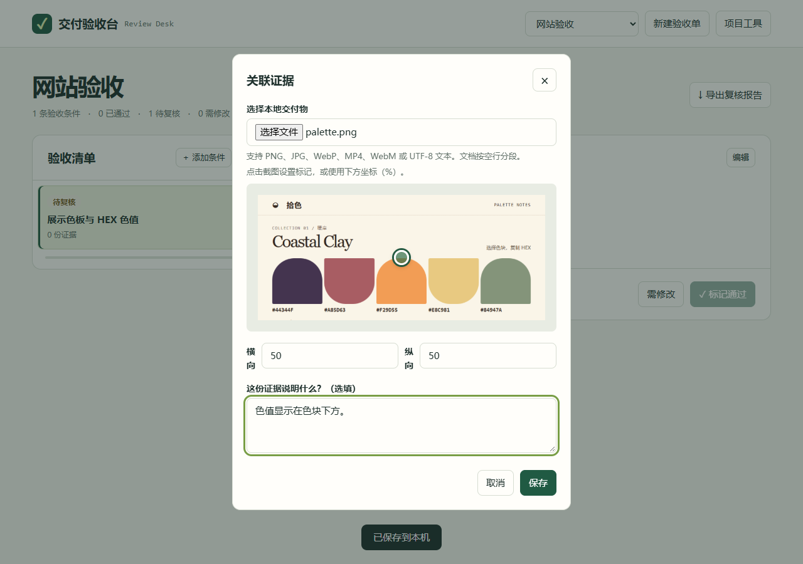

### 5. 关联视频

再次点击 **关联证据**，选择浏览器能够解码的 MP4 或 WebM 文件。把播放头移动到要检查的时刻，等待画面加载后点击 **保存**。以后可用 **回到标记** 返回该时间点。

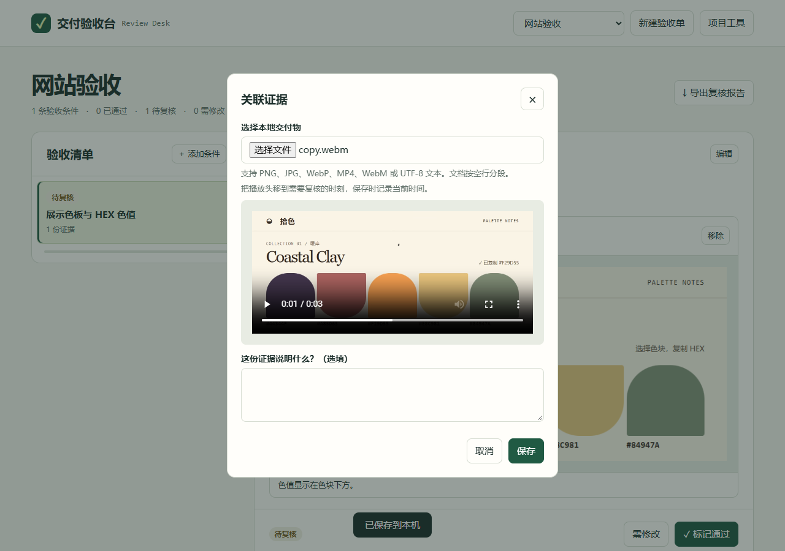

### 6. 关联文档

点击 **关联证据**，选择不超过 2 MB 的 UTF-8 TXT 或 Markdown 文件。在下拉菜单选择段落，确认下方摘录后保存。程序使用空行划分段落。

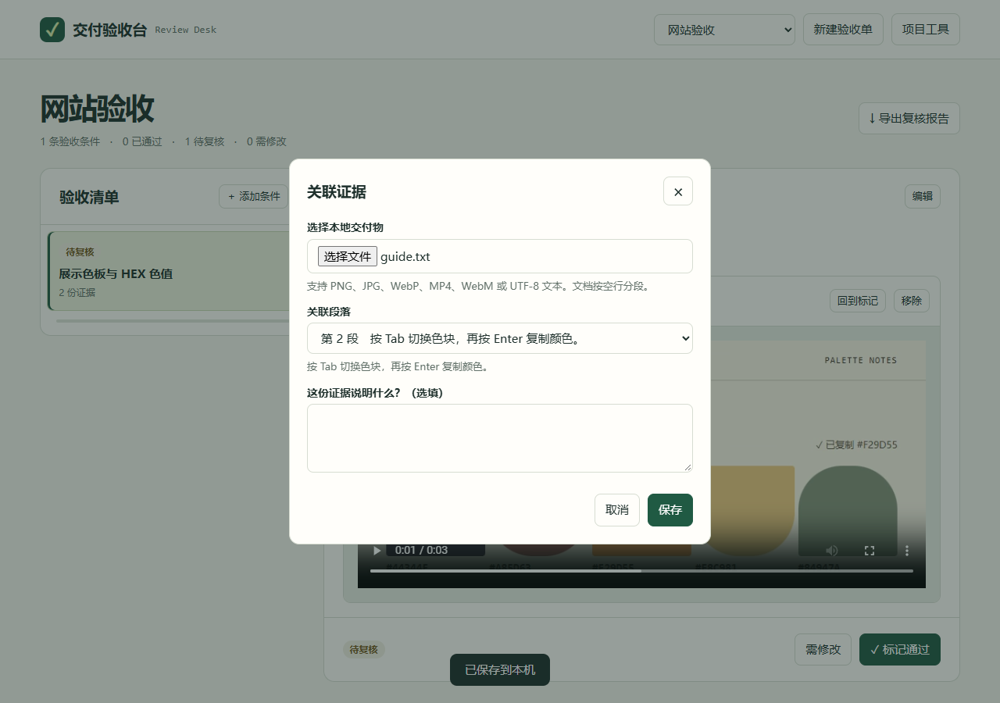

### 7. 记录复核结论

查看证据后选择 **标记通过** 或 **需修改**。通过前至少要关联一份证据。选择需修改时，填写意见并保存。编辑条件或增删证据后，结论会回到待复核。

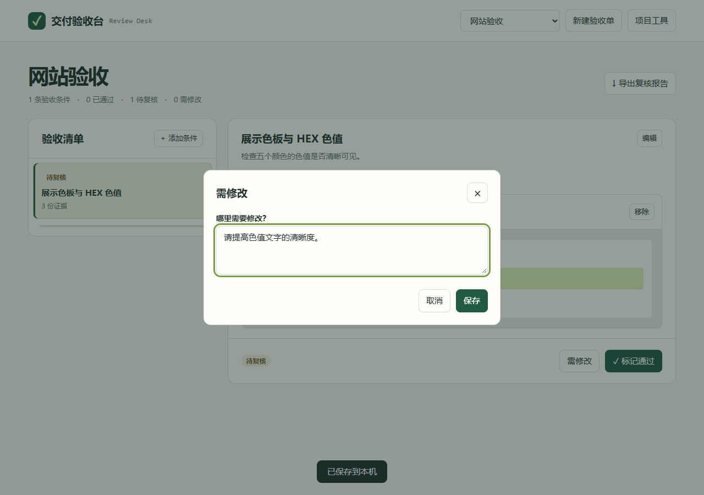

### 8. 生成修改指令

打开 **项目工具 → 生成修改指令**。检查或编辑生成的文字，点击 **下载**。Markdown 会列出需要修改的条件、意见和证据引用。交给执行修改的人或 AI 时，需另行提供引用的附件。

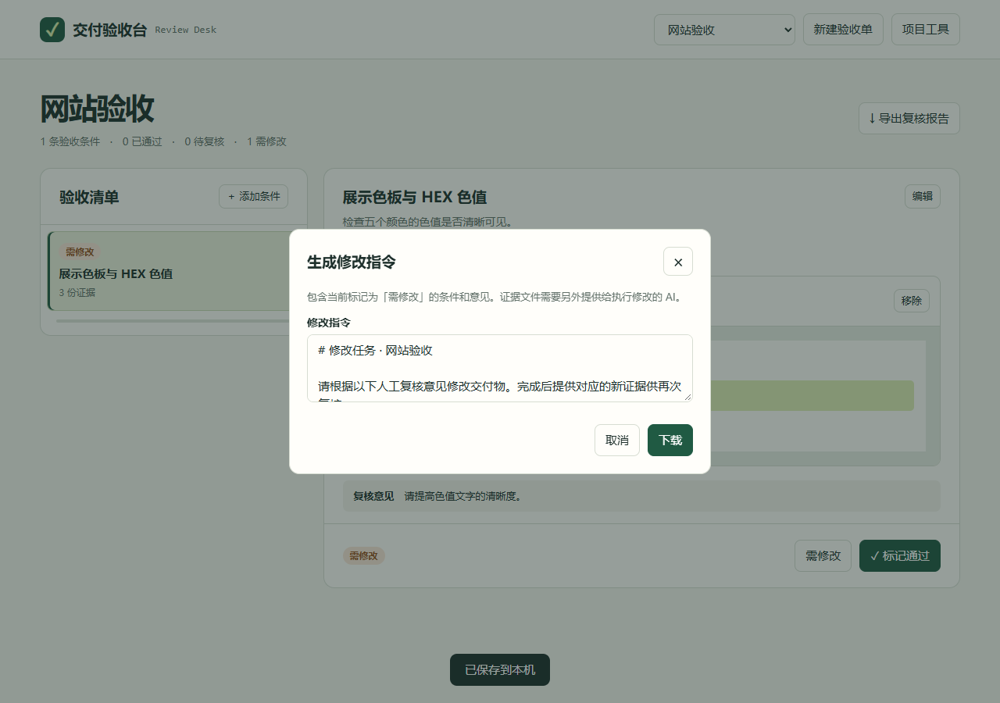

### 9. 使用 AI 辅助起草清单

打开 **项目工具 → 需求与 AI 清单**，填写项目需求。点击 **下载 AI 清单提示词**，将提示词交给外部 AI，检查返回结果后，把 JSON 数组粘贴到选填区域并保存。每项需要非空的 <code>title</code> 和文本类型的 <code>detail</code>。保存变更后的项目需求会将全部现有条件重置为待复核，并将旧结论记入变更历史。

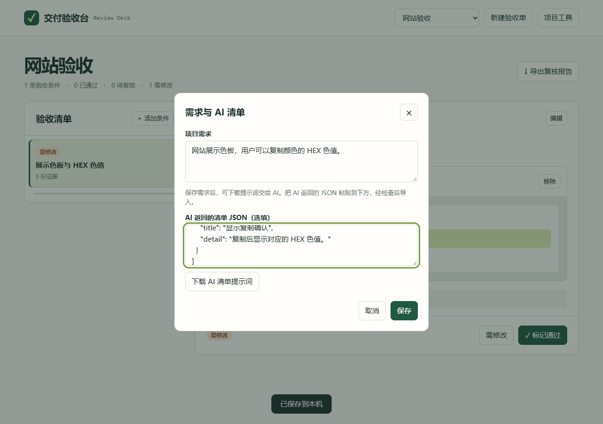

### 10. 跟踪需求变更

打开 **项目工具 → 追踪需求变更**。填写变更内容，勾选受影响的验收条件并保存。选中的条件回到待复核，之前的状态与意见可以在 **查看历史变更** 中找到。

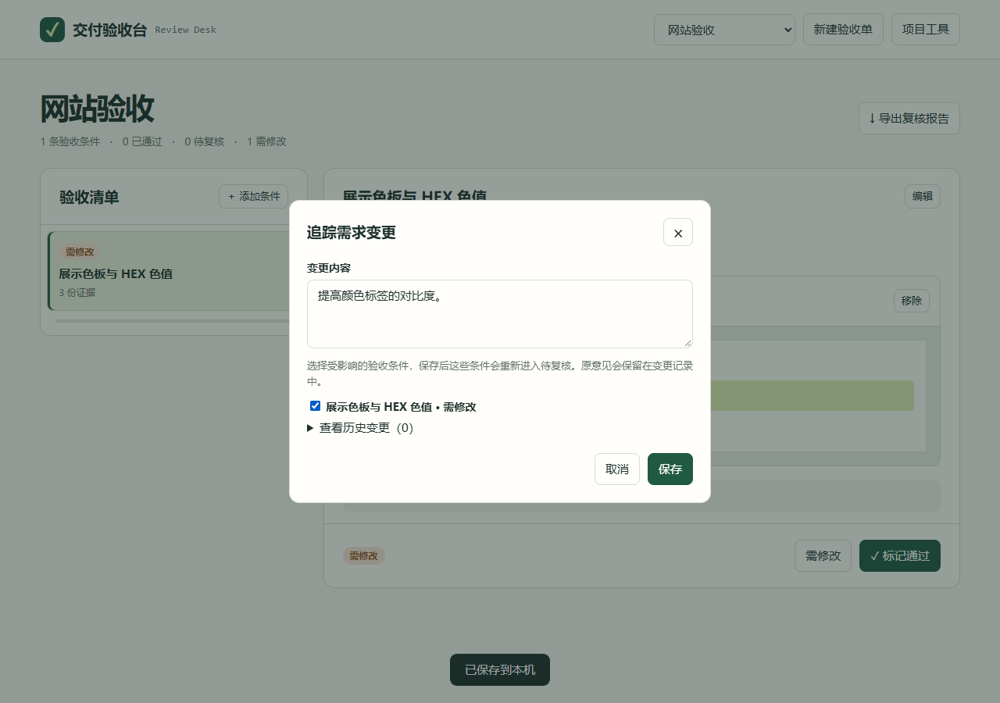

### 11. 对比截图

先为同一条件关联至少两张图片，再打开 **项目工具 → 对比证据**。通过「左侧」和「右侧」菜单选择图片，并排检查。示意图使用同一示例图片的两份副本展示操作位置。

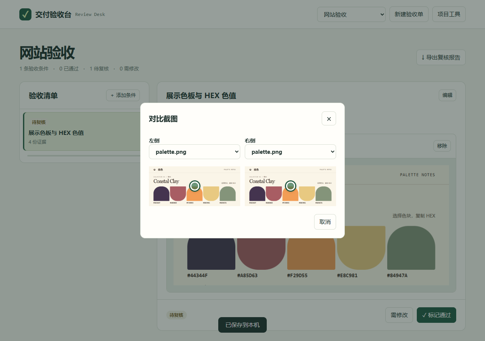

### 12. 导出验收报告

点击 **导出复核报告**。选择 HTML 可生成离线报告，其中包含完整图片、视频和文档全文。选择 Markdown 可导出结论、意见、文件名、定位及选中段落。点击 **导出** 下载。

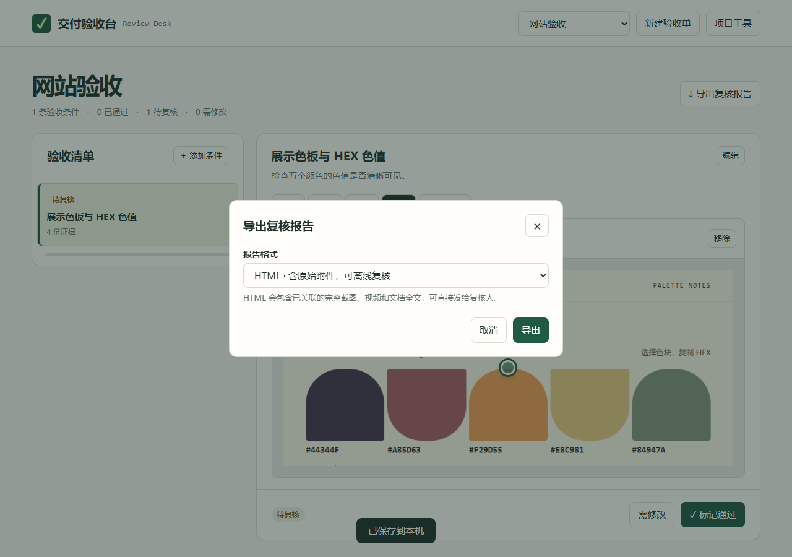

### 13. 备份项目

打开 **项目工具 → 导出项目备份**，下载包含当前验收单及附件的 JSON 文件。项目工具菜单中还包含上面介绍的其他操作。

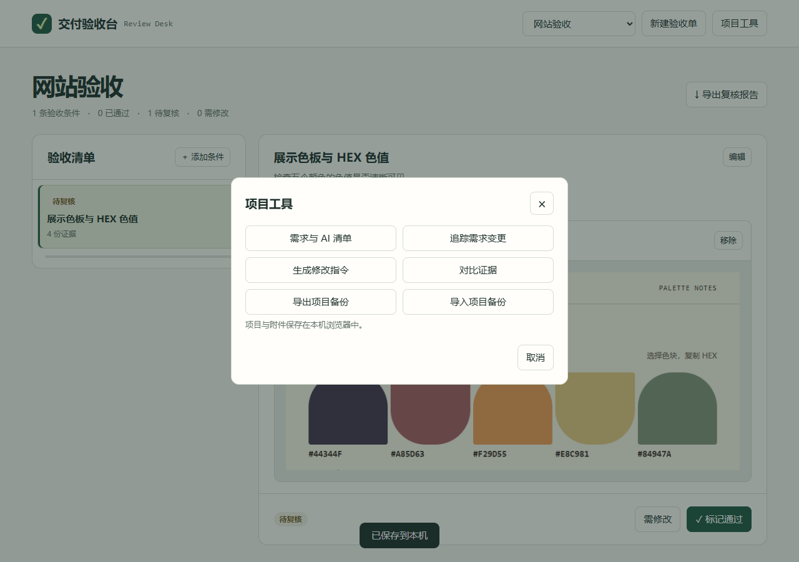

### 14. 导入项目备份

打开 **项目工具 → 导入项目备份**，选择 Review Desk 的 JSON 备份，点击 **保存**。导入会创建一个独立副本。项目数据存放在浏览器中，清理浏览器数据前可先备份。

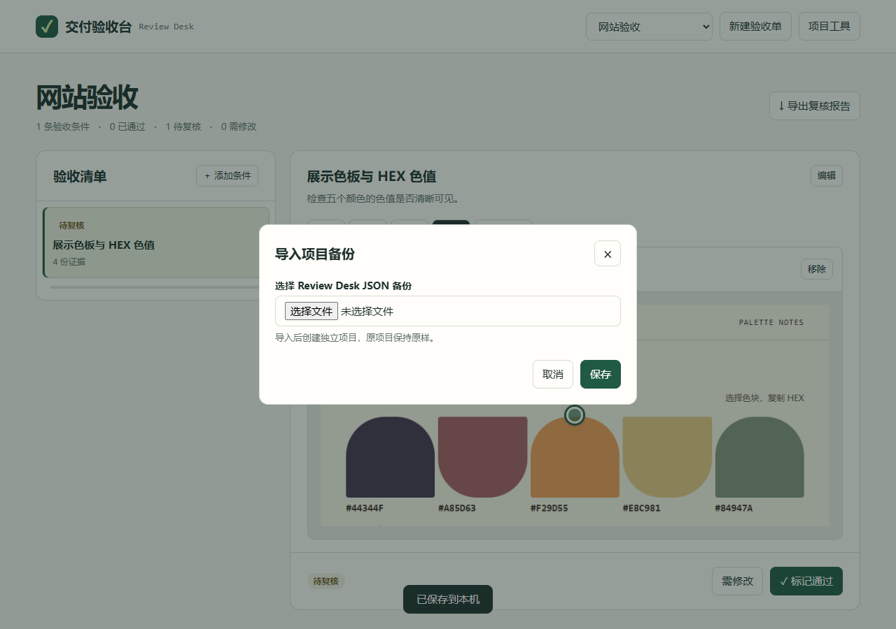


## 数据存储

项目和附件保存在浏览器的 IndexedDB 中。请使用同一浏览器配置并从同一路径打开程序。清理浏览器数据可能删除记录，大视频受浏览器存储配额限制。

HTML 报告和项目备份包含完整附件，分享前请检查内容。当前版本由使用者选择证据并作出复核结论，截图对比通过人工观察完成。

英文版和独立的中文版使用不同的浏览器存储。可以通过项目备份在两个版本之间转移验收单，项目中原有的文字保持原语言。

## 开发与测试

应用使用 HTML、CSS 和 JavaScript。浏览器测试需要 Node.js 和 Playwright。在可加载 Playwright 的环境中运行：

```sh
node tests/english.cjs
```

测试默认使用 Playwright Chromium。可将 `EDGE_PATH` 设置为本机 Edge 的可执行文件路径。
